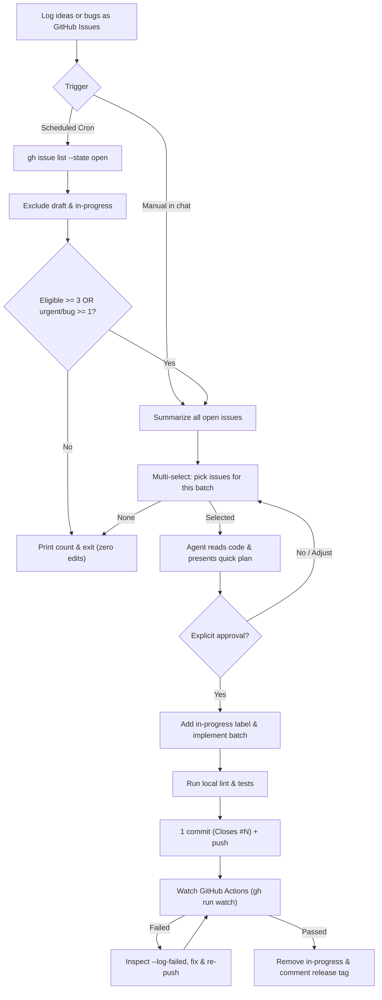

# issue-to-release

**English** | [Português (BR)](README.pt-BR.md)

An open **Agent Skill** for human-in-the-loop GitHub Issue triage, multi-select batching, explicit plan approval, single-commit delivery, automated CI monitoring + self-healing, and release commentary.

Compatible with **OpenAI Codex** (Desktop App & CLI), **Antigravity**, and **Claude Code** via the open `.agents/skills/` standard.

---

## Why Batch Issues?

Shipping one tiny commit per idea wastes CI minutes, pollutes git history, and spams releases. With **`issue-to-release`**:

1. You jot down ideas or bugs anytime as **GitHub Issues** (Web or GitHub Mobile).
2. A scheduled check (or manual chat command) watches the queue and waits until **3+ eligible issues** accumulate — or **1+ `urgent` / `bug`** appears.
3. The agent **never edits code unprompted**: it summarizes the queue, lets you pick which issues belong together, reads the affected files, and asks for your final OK on a short plan.
4. Once approved, it implements the entire batch, runs local checks, makes **1 consolidated commit** (`Closes #...`), watches GitHub Actions (auto-fixing CI failures if any occur), and comments the published release tag on every closed issue.



---

## Prerequisites

- **`git`** configured with push access to your repository.
- **GitHub CLI (`gh`)** installed and authenticated locally:
  ```bash
  gh auth login
  ```
- **Recommended (`AGENTS.md`):** add an `AGENTS.md` at your repository root documenting your lint, build, and test commands so the agent validates every batch accurately.

> [!NOTE]
> **Using OpenAI Codex?** Run this skill from the **Codex Desktop App (local workspace)** or **Codex CLI**. Cloud-sandboxed Codex Web environments restrict network/CLI access to `gh` and `git push` after container setup.

---

## Quick Setup (3 Steps)

### 1. Copy the skill into your repository

Copy `.agents/skills/issue-to-release/` into your project's root:

```text
your-repo/
└── .agents/
    └── skills/
        └── issue-to-release/
            ├── SKILL.md
            └── references/
                └── templates-and-labels.md
```

*(Optionally install globally for Codex/Antigravity/Claude in `~/.agents/skills/issue-to-release/` or `~/.gemini/config/skills/`.)*

### 2. Create the workflow labels (optional, recommended)

Run inside your repository:

```bash
gh label create "urgent" --color "b60205" --description "Trigger immediate triage without waiting for batch minimum" --force
gh label create "draft" --color "fbca04" --description "Work-in-progress idea — skipped by scheduled triage" --force
gh label create "in-progress" --color "1d76db" --description "Approved batch currently being implemented" --force
```

### 3. Add GitHub Issue Forms (optional)

Copy `templates/.github/ISSUE_TEMPLATE/` into your repository's `.github/ISSUE_TEMPLATE/` folder so logging adjustments or bugs from GitHub Mobile takes seconds.

---

## Usage

### On-Demand (Anytime)

- **OpenAI Codex (App or CLI):** invoke directly with `$issue-to-release` or ask `"Review open issues and pick a batch"`.
- **Antigravity / Claude Code:** ask `"Review open issues"` or `"Run issue-to-release"`.

### Scheduled / Cron Mode

Use your tool's scheduler to trigger `CRON` mode automatically (for example, Mondays & Fridays at 08:00):

- **OpenAI Codex Desktop App:** create a **Scheduled** task in your local repository with prompt:
  > Run `$issue-to-release` in CRON mode. If fewer than 3 eligible issues are open and none are labeled `urgent` or `bug`, report the count and exit without modifying any files.
- **Codex CLI + system `cron`:**
  ```cron
  0 8 * * 1,5 cd /path/to/your-repo && codex exec "Run \$issue-to-release in CRON mode."
  ```
- **Antigravity:** create a Scheduled Automation (`CRON_TZ=America/Sao_Paulo 0 8 * * 1,5`) pointing to `.agents/skills/issue-to-release/SKILL.md` in `CRON` mode with `gh` and `git` permissions granted.

---

## Optional: Save CI Minutes

See [`references/templates-and-labels.md`](.agents/skills/issue-to-release/references/templates-and-labels.md) for `paths-ignore`, `concurrency: cancel-in-progress: true`, and dependency caching snippets.

## License

[MIT](LICENSE)
