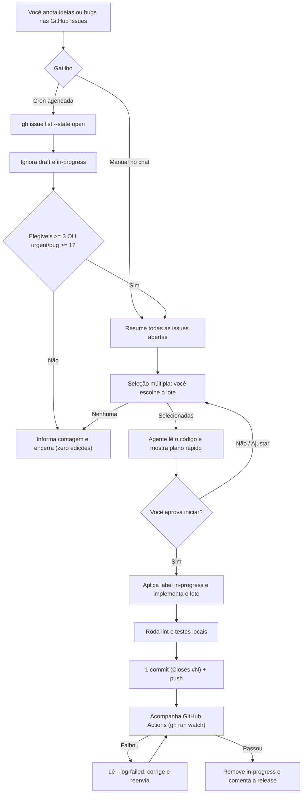

# issue-to-release

[English](README.md) | **Português (BR)**

Uma **Agent Skill** aberta para triagem de GitHub Issues com aprovação humana, seleção múltipla em lote, plano rápido antes de editar código, entrega em commit único, monitoramento de CI no GitHub Actions com autocorreção e comentário automático da release publicada.

Compatível com **OpenAI Codex** (App Desktop e CLI), **Antigravity** e **Claude Code** através do padrão aberto `.agents/skills/`.

---

## Por que trabalhar em lotes?

Fazer um commit pequeno para cada ideia desperdiça minutos de CI, polui o histórico do Git e gera várias releases vazias. Com a **`issue-to-release`**:

1. Você anota ideias ou bugs a qualquer hora direto nas **GitHub Issues** (Web ou GitHub Mobile).
2. Uma verificação agendada (ou comando manual no chat) monitora a fila e só aciona a triagem ao atingir **3+ issues elegíveis** — ou quando surgir **1+ issue `urgent` / `bug`**.
3. O agente **nunca edita código sem autorização**: resume a fila, deixa você marcar exatamente quais issues entram no lote, lê os arquivos afetados e pede seu OK em um plano rápido.
4. Após aprovado, implementa todo o lote junto, roda validações/testes locais, faz **1 único commit** (`Closes #...`), acompanha o GitHub Actions (corrigindo falhas automaticamente se ocorrerem) e comenta a tag da release em cada issue fechada.



---

## Pré-requisitos

- **`git`** configurado com acesso de push ao repositório.
- **GitHub CLI (`gh`)** instalado e autenticado localmente:
  ```bash
  gh auth login
  ```
- **Recomendado (`AGENTS.md`):** mantenha um `AGENTS.md` na raiz do projeto com os comandos de lint, build e testes para que o agente valide o lote antes de enviar.

> [!NOTE]
> **Usando OpenAI Codex?** Utilize o **Codex Desktop App (workspace local)** ou a **Codex CLI**. Ambientes web isolados na nuvem (*Codex Web*) restringem acesso de rede ao `gh` e `git push` após o setup do container.

---

## Instalação Rápida (3 Passos)

### 1. Copie a skill para o seu repositório

Copie a pasta `.agents/skills/issue-to-release/` para a raiz do seu projeto:

```text
seu-repo/
└── .agents/
    └── skills/
        └── issue-to-release/
            ├── SKILL.md
            └── references/
                └── templates-and-labels.md
```

*(Opcionalmente, você também pode instalar globalmente em `~/.agents/skills/issue-to-release/`.)*

### 2. Crie as labels de controle (opcional, recomendado)

Execute dentro do seu repositório:

```bash
gh label create "urgent" --color "b60205" --description "Dispara triagem imediata sem aguardar lote mínimo" --force
gh label create "draft" --color "fbca04" --description "Ideia em rascunho — ignorada pelo cron" --force
gh label create "in-progress" --color "1d76db" --description "Lote aprovado em implementação" --force
```

*(A skill também reconhece labels em português como `urgente`, `rascunho` e `em-andamento`.)*

### 3. Adicione formulários de Issue (opcional)

Copie `templates/.github/ISSUE_TEMPLATE/` para a pasta `.github/ISSUE_TEMPLATE/` do seu projeto para facilitar o registro de ajustes e bugs pelo celular no GitHub Mobile.

---

## Como Usar

### Sob Demanda (a qualquer hora)

- **OpenAI Codex (App ou CLI):** invoque diretamente com `$issue-to-release` ou peça `"Revisar issues abertas e montar um lote"`.
- **Antigravity / Claude Code:** peça `"Ver issues abertas"` ou `"Rodar issue-to-release"`.

### Modo Agendado / Cron

Configure o agendador da sua ferramenta para rodar no modo `CRON` (ex.: toda segunda e sexta às 08:00):

- **OpenAI Codex Desktop App:** crie uma tarefa em **Scheduled** apontando para o repositório local com o prompt:
  > Execute `$issue-to-release` em modo CRON. Se houver menos de 3 issues elegíveis e nenhuma com label `urgent` ou `bug`, informe a contagem e encerre sem alterar arquivos.
- **Codex CLI + `cron` do sistema:**
  ```cron
  0 8 * * 1,5 cd /caminho/do/repo && codex exec "Run \$issue-to-release in CRON mode."
  ```
- **Antigravity:** crie uma Automação agendada (`CRON_TZ=America/Sao_Paulo 0 8 * * 1,5`) apontando para `.agents/skills/issue-to-release/SKILL.md` em modo `CRON`, com permissões para os comandos `gh` e `git`.

---

## Opcional: Economizar Minutos de CI

Veja [`references/templates-and-labels.md`](.agents/skills/issue-to-release/references/templates-and-labels.md) para exemplos de `paths-ignore`, `concurrency: cancel-in-progress: true` e cache de dependências.

## Licença

[MIT](LICENSE)
